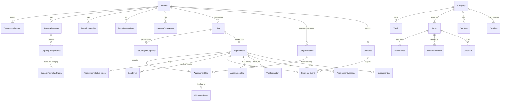

# Truck Appointment System (TAS) — Data Model & Capacity Logic

Status: draft v0.2
Target stack: ASP.NET Core API + React portal, PostgreSQL + PostGIS, multi-terminal (one deployment serves many terminals).

> **Naming:** this document uses PascalCase entity names (as in the C# model). In the database (`db/schema.sql`) the same tables and columns are snake_case — e.g. `CapacityTemplateSlot.TotalCapacity` → `capacity_template_slot.total_capacity`. All instants are stored as UTC `timestamptz`; the terminal's IANA time zone is applied when generating slots and displaying times.
>
> **Database portability:** all data access goes through EF Core. Only the booking-counter updates (section 4.5) are hand-written SQL, kept in one class, so a SQL Server provider can be added for on-premise customers who require it.

---

## 1. Design principles

1. **Multi-terminal from day one.** Every operational table carries `TerminalId`.
2. **Capacity is configured as rules, consumed as materialized slots.** Operators edit templates and overrides; a generator turns them into concrete `Slot` rows for a rolling horizon (e.g. 14 days). Bookings decrement counters on those rows. This keeps booking fast and race-safe.
3. **One booking model for container and multipurpose cargo.** An appointment = one truck visit. It holds 1..n items; an item is either a container move or a cargo move (BL/cargo ref + trips/tonnage).
4. **Validate early, record why.** Every TOS/customs check result is stored, so the gate and the help desk see the same reason.
5. **Everything auditable.** Capacity changes and appointment status changes are logged with user, time and reason.

---

## 2. Entity overview



---

## 3. Tables by area

### 3.1 Terminal & configuration

| Table | Purpose | Key columns |
|---|---|---|
| `Terminal` | Tenant | Code, Name, TimeZone, SlotMinutes (30/60), BookingHorizonDays, TerminalType (CONTAINER / MULTIPURPOSE) |
| `TerminalSetting` | Key/value rules per terminal | EarlyGraceMin, LateGraceMin, CancelCutoffMin, MaxApptPerTruckPerDay, NoShowPenaltyEnabled, … |
| `Gate` / `GateLane` | Optional lane-level detail | LaneCode, Direction (IN/OUT), IsActive |
| `TransactionCategory` | Configurable per terminal | Code (IMP_PICKUP, EXP_DROP, MTY_RETURN, MTY_PICKUP, BB_DELIVERY, BB_RECEIVAL, BULK_DELIVERY, RORO_PICKUP…), Mode (CONTAINER / CARGO), UnitType (MOVE / TRIP), SortOrder |

### 3.2 Capacity configuration (what operators edit)

| Table | Purpose |
|---|---|
| `CapacityTemplate` | A weekly pattern. `IsDefault=1` has no dates. Seasonal templates (Ramadan, summer) have `ValidFrom/ValidTo` and a `Priority`. |
| `CapacityTemplateSlot` | One row per weekday + time window in a template: `DayOfWeek`, `StartTime`, `EndTime`, `TotalCapacity`, `OverbookPct`. |
| `CapacityTemplateQuota` | Max units per category inside a template slot. Quotas may sum to more than `TotalCapacity` — the total is the real ceiling. |
| `CapacityOverride` | Exceptions for specific dates/hours: `StartAt`, `EndAt`, `CategoryId` (NULL = total), `Action` (SET / ADJUST / CLOSE), `Value`, `Reason`. |
| `QuotaReleaseRule` | Release unused category quota to the shared pool N hours before slot start. |
| `CapacityReservation` | Units held back for a company (priority customer) or for walk-ins/emergency, with a release time. |

### 3.3 Materialized capacity (what bookings consume)

| Table | Purpose |
|---|---|
| `Slot` | Concrete time window for a terminal: `StartAt`, `EndAt`, `TotalCapacity` (effective, incl. overbook), `TotalBooked`, `IsClosed`, `OverCapacity`. Optimistic concurrency uses PostgreSQL's `xmin`. |
| `SlotCategoryCapacity` | Per slot per category: `QuotaCapacity`, `Booked`. |

### 3.4 Parties

| Table | Purpose |
|---|---|
| `Company` | Trucking company / forwarder / consignee. CR number, status, IsPriority, NoShowCount. |
| `AppUser` | Portal users (company staff, terminal operators). Role, PreferredLanguage. |
| `Truck` | PlateNumber (normalized for OCR matching), CompanyId, IsBlocked. |
| `Driver` | Name, IdNumber, Mobile, PreferredLanguage (ar/en/ur/hi), CompanyId. |

### 3.5 Booking

| Table | Purpose |
|---|---|
| `Appointment` | One truck visit: `AppointmentNo`, `SlotId`, `CompanyId`, `TruckId`, `DriverId`, `Status`, `QrToken`, `IsDual`, gate-in/out times, `NoShow`. |
| `AppointmentItem` | One move: `CategoryId`, then either container fields (`ContainerNo`, `IsoType`, `BookingRef`/`EdoRef`) or cargo fields (`CargoAllocationId`, `Trips`, `PlannedTonnage`, `ActualTonnage`). `ValidationStatus`, `TosRef`. |
| `ValidationResult` | One row per check per item: `CheckType` (AVAILABILITY, CUSTOMS_RELEASE, LINE_RELEASE, TERMINAL_HOLD, PAYMENT, BOOKING_VALID, VGM, CUTOFF), `Result` (PASS/FAIL/WARN), `Message`, `Source` (N4 / FASAH / internal), `CheckedAt`. |
| `CargoAllocation` | Multipurpose: BL/cargo reference with `TotalTonnage` / `TotalTrips` and delivered-so-far, so bookings can't exceed the cargo. |
| `AppointmentStatusHistory` | Status transitions with user and reason. |

Appointment statuses: `DRAFT → CONFIRMED → EN_ROUTE → ARRIVED → GATE_IN → COMPLETED`, with side exits `CANCELLED`, `NO_SHOW`, `REJECTED_AT_GATE`.

`Appointment` also carries the driver-facing **traffic light** (`TrafficLight` GREY/GREEN/AMBER/RED + `TrafficReason`), the latest `CurrentEta`, and `CheckInMethod`.

### 3.6 Gate & audit

| Table | Purpose |
|---|---|
| `GateEvent` | Autogate/OCR events: `LaneId`, `EventType` (OCR_READ, MATCHED, NO_APPT, EARLY, LATE, GATE_IN, GATE_OUT, TROUBLE), `PlateRead`, `ContainerRead`, `OccurredAt`. |
| `AuditLog` | Generic change log for capacity config and settings: entity, key, old/new JSON, user, reason. |

`GateEvent` also records `APP_CHECKIN` (geofence/app check-in) and `PASS_SCAN` (digital gate pass scanned at a lane).

### 3.7 Driver app — identity, devices, gate pass

| Table | Purpose |
|---|---|
| `DriverDevice` | The phone a driver is logged in on: push token, platform, app version. One active device per driver; a new login deactivates the old one. |
| `DriverVerification` | How the driver's identity was confirmed: `MOBILE_OTP`, `ID_OTP`, `NAFATH`, `LIVENESS`, or `CLERK_MANUAL`. Stores vendor reference only, never ID images. |
| `GatePass` | Digital gate pass per driver (terminal-specific or all terminals). The app shows a **rotating QR** derived from `PassSecret` (TOTP-style), so a screenshot can't be reused. |

### 3.8 Geofencing & ETA

| Table | Purpose |
|---|---|
| `Geofence` | Zones per terminal: APPROACH (e.g. 10 km), PARKING, PRE_GATE, GATE, YARD_ZONE (linked to TOS block), CFS, EXIT. `TriggersCheckIn` marks the zone that auto-checks-in. |
| `GeofenceEvent` | ENTER / EXIT / DWELL per appointment. Drives status changes (EN_ROUTE → ARRIVED), yard-stop arrival, and turn-time KPIs. |
| `AppointmentEta` | ETA snapshots while EN_ROUTE. Used for the live arrivals board and for flagging trucks that will miss their window. |

**Privacy:** location is collected only between "Start trip" and gate-out for an active appointment, with explicit consent in the app. No continuous tracking outside visits.

### 3.9 Yard guidance

| Table | Purpose |
|---|---|
| `YardInstruction` | Ordered stops for the visit (transfer point, block/lane, CFS, weighbridge, inspection, exit), with Arabic/English text. Populated from the TOS after gate-in; a dual visit gets two or more stops. Entering the stop's geofence marks it ARRIVED. |

### 3.10 Communication & integration

| Table | Purpose |
|---|---|
| `AppointmentMessage` | Driver ↔ control room chat: text, voice notes, call requests, location, and **templated messages** (e.g. "Go to trouble desk") auto-shown in the driver's language. |
| `NotificationLog` | Outbox of every push / SMS / WhatsApp / email: template, language, recipient, status (queued / sent / failed / skipped), attempts, next attempt, last error. |
| `ApiClient` | Credentials, scopes and rate limits for trucking companies booking from their own TMS. |

### 3.11 Traffic-light logic (driver app)

Recalculated on any validation result, slot change, or ETA/geofence event:

| Light | Condition | Example reason shown |
|---|---|---|
| GREY | Appointment not yet within reach (more than X hours away) | "Appointment tomorrow 10:00" |
| GREEN | All items PASS and current time/ETA within slot ± grace | "Ready — proceed to gate" |
| AMBER | WARN result, or ETA predicts late arrival but still within grace | "You may be late — reschedule?" |
| RED | Any FAIL (hold, not available, unpaid) or outside window | "Customs hold on MSCU1234567" |

---

## 4. Capacity resolution

### 4.1 Precedence (most specific wins)

1. **Default template** (`IsDefault = 1`)
2. **Seasonal template** — the highest-`Priority` dated template whose date range covers the slot date replaces the default *entirely* for that day.
3. **Overrides** — applied on top, in order of `CreatedAt`:
   - `CLOSE` → slot (or category) = 0
   - `SET` → value replaces
   - `ADJUST` → value is added (can be negative)
   - `CategoryId NULL` targets the slot total; otherwise the category quota.

### 4.2 Slot generation (background job)

Runs nightly for the booking horizon, and immediately after any template/override change for the affected dates.

```
for each terminal, for each date in [today, today + horizon]:
    template = seasonal template covering date (max priority) ?? default template
    for each templateSlot in template where DayOfWeek = date.DayOfWeek:
        split into windows of Terminal.SlotMinutes
        total  = templateSlot.TotalCapacity
        quotas = templateSlot quotas by category
        apply overrides overlapping the window (CLOSE / SET / ADJUST)
        effectiveTotal = floor(total * (1 + OverbookPct/100))
        UPSERT Slot (keep TotalBooked)
        UPSERT SlotCategoryCapacity (keep Booked)
        if Booked > new capacity -> flag slot OVER_CAPACITY, notify operators
                                   (never auto-cancel existing bookings)
```

### 4.3 Availability at booking time

For slot `s`, category `c`, at time `now`:

```
reserved     = sum(active CapacityReservation units for s not yet released,
                   excluding the booking company's own reservation)
freeTotal    = s.TotalCapacity - s.TotalBooked - reserved

if now >= s.StartAt - releaseHours(c):        // quota released to pool
    freeCategory = freeTotal
else:
    freeCategory = min(quota(s,c) - booked(s,c), freeTotal)

available = s.IsClosed ? 0 : max(0, freeCategory)
```

### 4.4 Counting rules

- One appointment consumes **1 unit of slot total** (one truck at the gate).
- Each item consumes **1 unit of its category quota**. A dual transaction (export drop + import pickup) therefore consumes 1 total + 1 EXP_DROP + 1 IMP_PICKUP.
- Cargo (multipurpose) items consume 1 unit per trip, and draw down `CargoAllocation`.

### 4.5 Race-safe booking

Inside one DB transaction:

```sql
UPDATE slot
   SET total_booked = total_booked + 1
 WHERE slot_id = @slot_id AND NOT is_closed
   AND total_booked + 1 <= total_capacity - @reserved;
-- 0 rows affected -> slot full, rollback

UPDATE slot_category_capacity
   SET booked = booked + 1
 WHERE slot_id = @slot_id AND category_id = @category_id
   AND (@quota_released OR booked + 1 <= quota_capacity);
-- repeat per category in the appointment; any 0 rows affected -> rollback
```

Each statement is atomic on its row, so two users racing for the last unit cannot both succeed — no explicit locks needed.

Cancellation / no-show reverses the counters in the same way (no-show only after the late-grace window passes).

---

## 5. Open decisions

1. Slot length: fixed per terminal (30/60 min), or allow different lengths by time of day?
2. Should seasonal templates replace the default for the whole day (proposed), or be allowed to cover only some hours?
3. Fees: free booking, paid booking, or penalties for no-show/late only?
4. TOS integration path for the first customer: N4 web services, EDI, or DB views?
5. Is there a national appointment platform the first customer's port must integrate with?
6. Driver identity: is mobile OTP + ID number enough for the first customer, or is Nafath / liveness verification required for ISPS?
7. Gate pass: does the gate scan the driver's QR at a lane reader, or is check-in purely geofence + OCR plate match?
8. Yard guidance source: can N4 provide the block/lane/transfer point per truck visit in real time for this customer?
